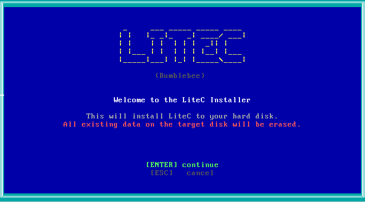
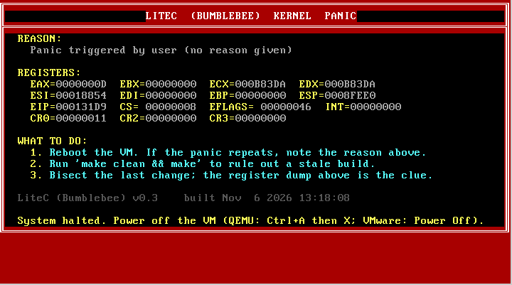
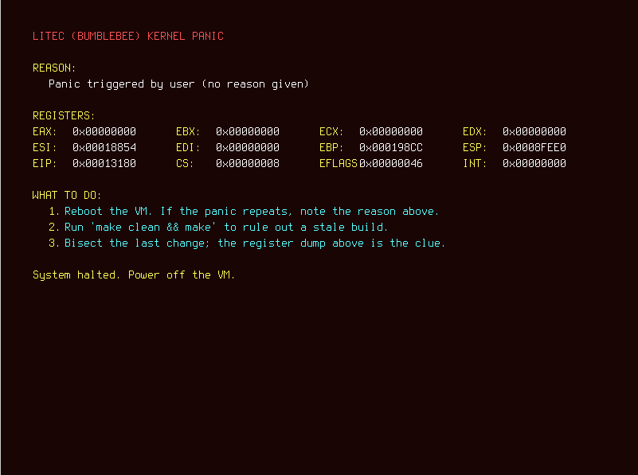

# 🐝 LiteC (Bumblebee)

**A minimal, custom 32-bit x86 operating system built entirely from scratch.**

[-lightgrey.svg)](#)

  

  

  

## 📖 What is LiteC?

LiteC v0.3 (codenamed **Bumblebee**) is a hobby operating system built without any external libraries, frameworks, or existing kernels. It features a custom two-stage bootloader, a monolithic kernel written in C and Assembly, a custom on-disk filesystem, and a graphical desktop environment.

It is designed to be a playground for OS development, demonstrating how to bridge the gap between raw hardware and a modern-looking UI.

---

## ✨ Features

*   **Custom Bootloaders:** Floppy (CHS) and Hard Disk (LBA) boot sectors that set up VESA video modes and enter 32-bit Protected Mode.
*   **Multiple Keyboard Layouts** German and English keyboard layout. (Can be choosed in installer)
*   **Semi-Sound Support (in development)** Sound Support
*   **OPEN SOURCE** You can modify this in anyway. Just give credit (e.g. Made with LiteC OS)
*   **Custom Filesystem (LiteFS):** A persistent on-disk filesystem featuring a superblock, inode table, and contiguous block allocation.
*   **Graphical Desktop:** A framebuffer-driven GUI featuring:
    *   Dark-mode gradient wallpapers and a custom Taskbar.
    *   Alpha-blended, rounded-corner windows with smooth drop shadows.
    *   Draggable windows and interactive UI elements (hover states, buttons).
    *   Hardware mouse cursor driven by a PS/2 driver.
*   **Modular Shell:** A command-line interface where commands are registered via linker sections (`.commands`). Adding a new command is as simple as creating a new `.c` file.
*   **LiteC Software (`.lcs`):** A custom executable format. The OS can load flat binary programs into memory and expose a basic syscall table for drawing and printing.
*   **Host Tooling:** Includes a Python tool to inject `.lcs` programs directly into the disk image from Linux/WSL without booting the OS.

---

## 🚀 Getting Started
### Ready2Use
download the disk.img file and boot it in qemu
Specs:
512mb ram (minimum) / 2GB ram (recommended)
1 CPU Core (minimum) / 4 Cores (recommended)
16mb VRAM (minimum) / 256mb VRAM (recommended)
### Prerequisites (WSL/Ubuntu)

You will need a cross-compiler, `nasm`, `qemu`, and `python3`:

sudo apt update
sudo apt install -y nasm gcc-multilib qemu-system-x86 make xxd python3

### Clone the source code
I hope you know how to do that. If not, this is not the right thing for you to do :)
### Make and Compile
1. run "make"
2. run "dd if=/dev/zero of=disk.img bs=1M count=128 status=none" (adjust count to specify disk space in MB (default 128) )
3. run "qemu-system-i386 \
    -drive format=raw,file=disk.img,if=ide,cache=writeback \
    -display gtk"
You should have now booted into the LiteC commandline
Depending on your computer framebuffer may be supported. You can tell if the Text looks sharp and not blurry
## What to do now?
### Using the Graphical Enviroment
execute "graphics-launch" to launch the desktop
VERY BUGGY! in development
### Using the command line
type help for a full view of command to use
sync is deprecated. will be removed in future releases
Alternatively if you have problems with the VGA driver, rename vga.c.legacy to vga.c, delete the standard one and remake
!! THIS IS NOT FAT32/NTFS
This is a custom file system
## Thanks for reading and I hope you have much fun with this
# Making LCS apps
Follow Instructions in LCS_FORMAT_DOCUMENTATION
everything you need is in tools/
